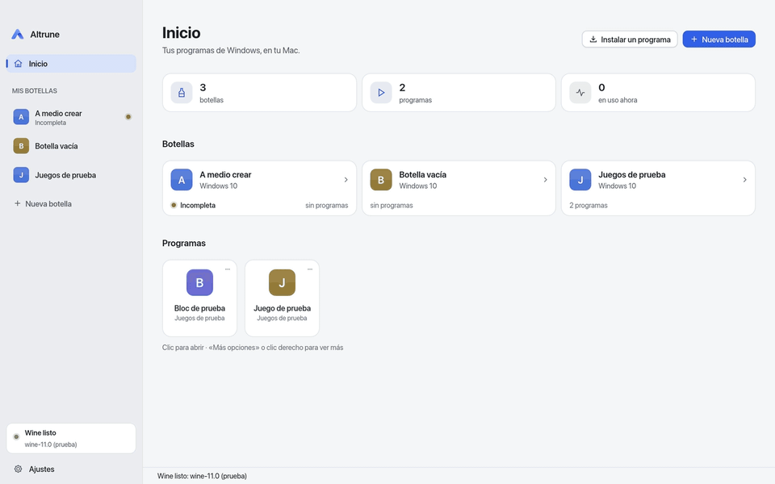
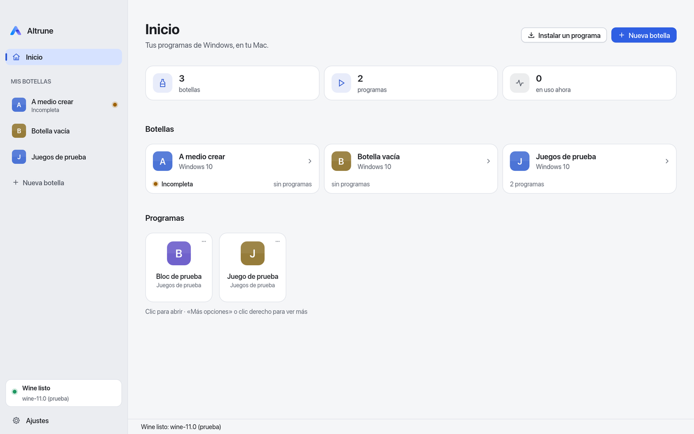
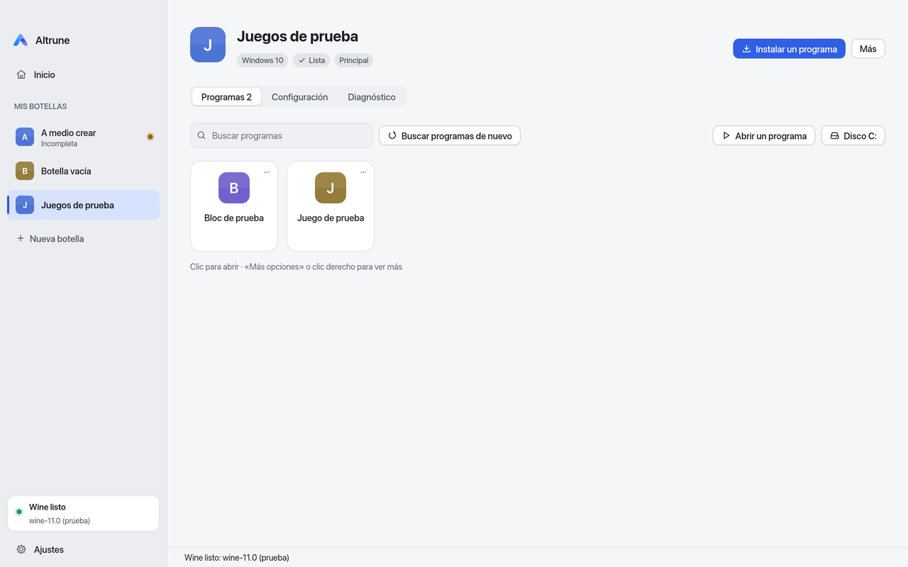
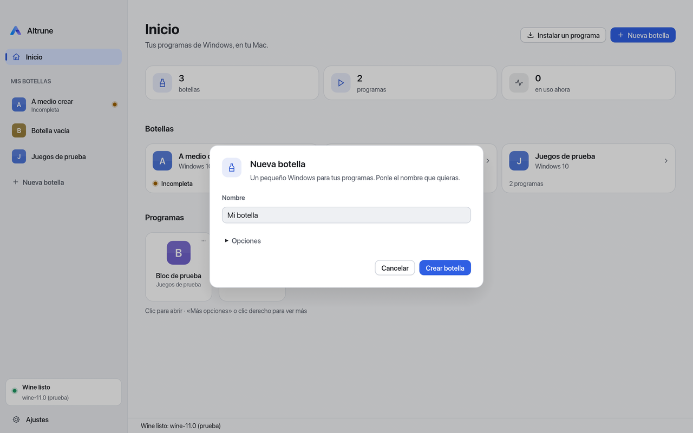
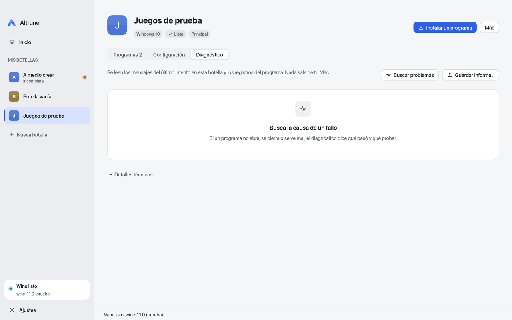
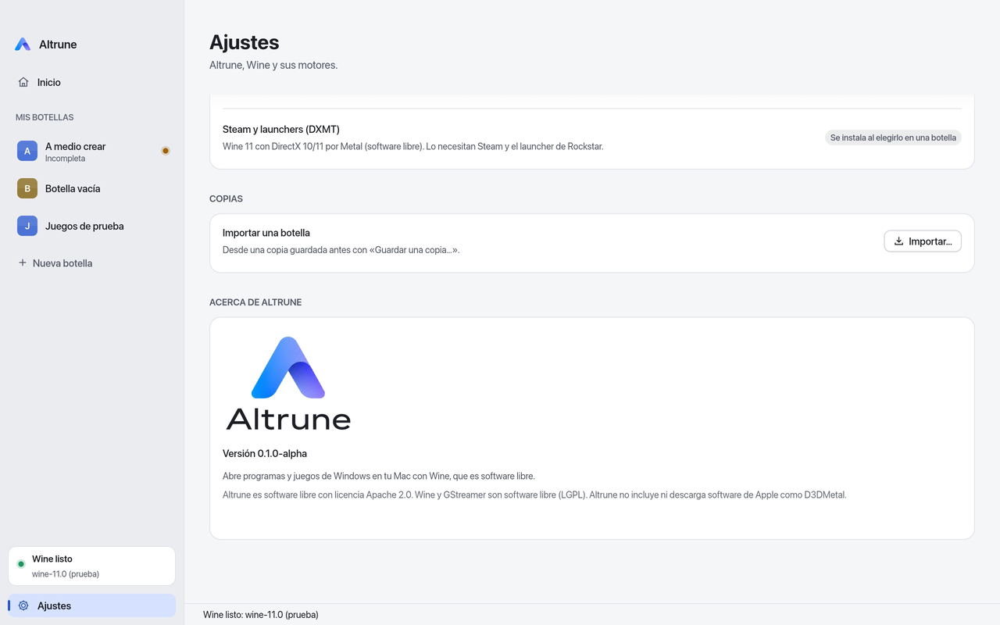
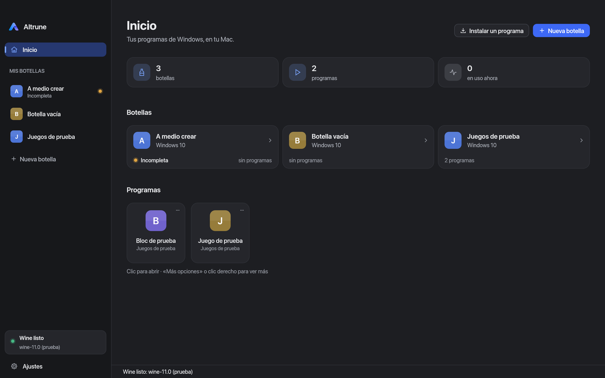
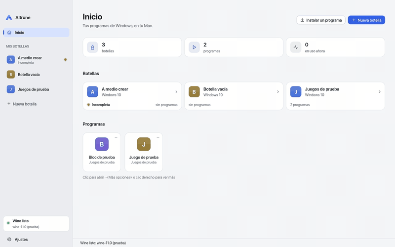
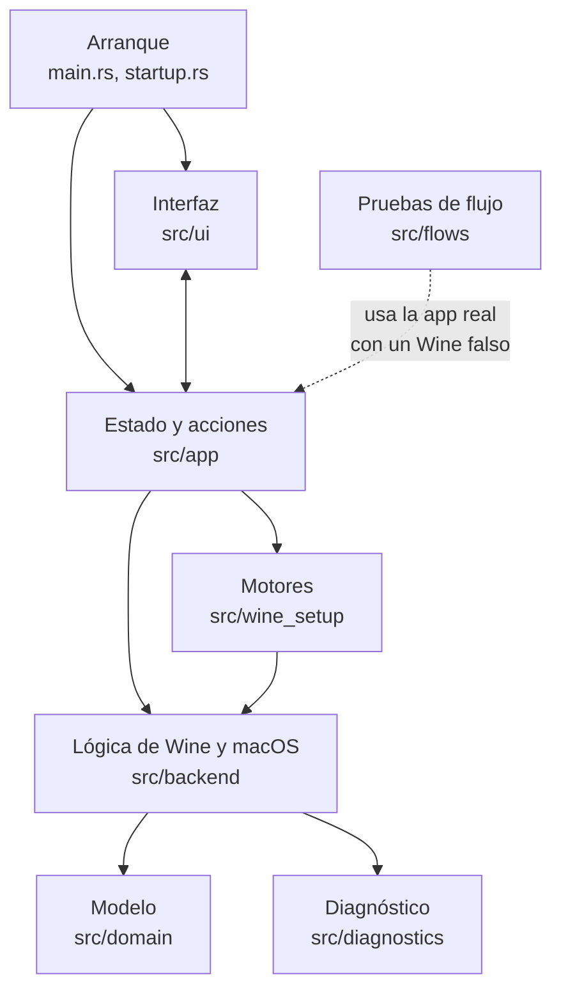

<div align="center">



# Altrune

**Tus programas de Windows, en tu Mac.**

Altrune ejecuta programas de Windows en macOS con Wine libre. Crea «botellas», instala con un asistente, abre los programas con un clic y explica los errores en español.

[](https://github.com/Franks2103/altrune/actions/workflows/ci.yml)
[](LICENSE)
[-lightgrey?logo=apple)](#requisitos-y-compatibilidad-comprobada)
[](#instalación-para-desarrollar)
[](#limitaciones-conocidas)

[Instalación](#instalación-para-desarrollar) · [Uso](#uso-básico) · [Arquitectura](#arquitectura) · [Contribuir](#contribuir)

<br>



</div>

<details>
<summary><b>English summary</b></summary>

<br>

Altrune is a macOS desktop app, written in Rust with eframe/egui, that runs Windows programs on a Mac with free Wine. It manages bottles (Wine prefixes), has a guided installer, keeps a library of the installed programs, integrates with Finder and Launchpad, explains errors in plain language and downloads the engines it needs at run time: the standard Wine build automatically on first start if none is found, and DXMT and GStreamer only on request (controller support is built on the Mac from source). It does not download, install or redistribute Apple's D3DMetal or Game Porting Toolkit; if a Mac already has them, Altrune detects and uses them, so Direct3D 12 games are a known limitation. The interface and the documentation are in Spanish; code, comments and commit messages are in English. It is independent and is not affiliated with Apple, Valve or Rockstar Games. Status: pre-release, built from source only, tested on one Mac (Apple chip, macOS 27). Licence: Apache-2.0, see [Licencia](#licencia).

</details>

## Contenido

* [Qué es Altrune](#qué-es-altrune)
* [Características](#características)
* [Cómo funciona](#cómo-funciona)
* [Capturas](#capturas)
* [Requisitos y compatibilidad comprobada](#requisitos-y-compatibilidad-comprobada)
* [Instalación para desarrollar](#instalación-para-desarrollar)
* [Compilar y ejecutar](#compilar-y-ejecutar)
* [Empaquetar y publicar](#empaquetar-y-publicar)
* [Uso básico](#uso-básico)
* [Motores y componentes](#motores-y-componentes)
* [Arquitectura](#arquitectura)
* [Calidad y pruebas](#calidad-y-pruebas)
* [Hoja de ruta](#hoja-de-ruta)
* [Limitaciones conocidas](#limitaciones-conocidas)
* [Contribuir](#contribuir) · [Seguridad](#seguridad) · [Código de conducta](#código-de-conducta)
* [Licencia](#licencia)
* [Agradecimientos](#agradecimientos)

## Qué es Altrune

Altrune es una app de escritorio para Mac que ejecuta programas de Windows con Wine libre. Cada «botella» es un pequeño Windows con sus propios programas y ajustes (lo que Wine llama un prefijo). Altrune las crea, instala programas dentro con un asistente, los abre desde Finder o desde Launchpad y, cuando algo falla, dice qué pasó y qué probar.

Está escrita en Rust con eframe/egui: un único binario, sin servicios ni telemetría.

**Estado:** versión previa a la primera publicación. La primera versión será la **0.1.0-alpha**. Todavía no existe ninguna descarga firmada y notarizada: Altrune se compila desde el código fuente, y los scripts de [Empaquetar y publicar](#empaquetar-y-publicar) ya construyen el instalador `.dmg`, pero sin firma de Apple.

## Características

Solo se listan funciones comprobadas por las pruebas automáticas o por pruebas con la app real descritas en [`docs/roadmap.md`](docs/roadmap.md) y [`docs/testing/`](docs/testing/).

<table>
<tr>
<td valign="top" width="33%"><strong>Botellas</strong><br>Crear, renombrar, duplicar, copiar y borrar; elegir la versión de Windows; detectar una botella incompleta y explicar qué falta.</td>
<td valign="top" width="33%"><strong>Instalador guiado</strong><br>Suelta o elige un <code>.exe</code> o <code>.msi</code>; la app propone una botella y no marca ningún paso como hecho antes de comprobarlo.</td>
<td valign="top" width="33%"><strong>Biblioteca de programas</strong><br>Detecta los programas de cada botella (lee los accesos <code>.lnk</code>), evita duplicados, busca sin tildes y permite ocultarlos.</td>
</tr>
<tr>
<td valign="top" width="33%"><strong>Finder y Launchpad</strong><br>«Abrir con» desde Finder para los <code>.exe</code>, con una sola app abierta a la vez, y una app de Mac por programa si se activa.</td>
<td valign="top" width="33%"><strong>Buscar problemas</strong><br>Diagnóstico por reglas, sin servicios externos: lee los mensajes del último intento y dice qué pasó y qué probar.</td>
<td valign="top" width="33%"><strong>Informes sin datos personales</strong><br>El informe guardado oculta nombre de usuario, correos, identificadores de Steam, contraseñas y tokens conocidos. Revísalo antes de compartirlo.</td>
</tr>
<tr>
<td valign="top" width="33%"><strong>Motores a la carta</strong><br>«Wine normal» al primer arranque; «Steam y launchers» (DXMT) y vídeo solo cuando los pides.</td>
<td valign="top" width="33%"><strong>Descargas verificadas</strong><br>Las descargas con suma SHA-256 fijada se comprueban antes de desempaquetarse; un cambio de motor nunca deja uno a medias.</td>
<td valign="top" width="33%"><strong>Accesible</strong><br>Teclado completo, nombres y roles para VoiceOver (AccessKit) y contraste mínimo de 4,5:1 en tema claro y oscuro.</td>
</tr>
</table>

Además: apariencia automática (como el Mac), clara u oscura; y nada de telemetría. Las botellas viven solo en la carpeta de datos de Altrune y Wine nunca se ejecuta en un prefijo de fuera de ella.

## Cómo funciona

<picture>
  <source media="(prefers-color-scheme: dark)" srcset="docs/media/como-funciona-oscuro.svg">
  
</picture>

## Capturas

Las capturas se hicieron con datos simulados: una carpeta personal falsa y un Wine falso que no ejecuta nada (`tools/hogar-aislado.sh`). Las botellas y los programas que aparecen no existen.

| | | |
|:---:|:---:|:---:|
|  |  |  |
| Inicio | Una botella y sus programas | Crear una botella |
|  |  |  |
| Diagnóstico de una botella | Acerca de Altrune | Tema oscuro |

<p align="center">
  
</p>

## Requisitos y compatibilidad comprobada

Lo único que se ha probado de verdad:

| | Comprobado |
|---|---|
| Mac | uno solo, con **chip de Apple** (M5) |
| macOS | **27** |
| Compilador | Rust **1.100.0**; eframe 0.37 exige como mínimo Rust 1.95 |

Qué no se ha probado y no se promete:

* El paquete declara **macOS 11** como mínimo (lo lee `tools/empaquetar.sh` del binario), pero no se ha probado en macOS 11 ni en ninguna otra versión anterior a la 27.
* **Macs con Intel** no se han probado. La interfaz ofrece los motores por Metal solo con chip de Apple.
* El motor «Steam y launchers» necesita **chip de Apple y macOS 14 o posterior**; si no, aparece como «No disponible».
* Las compilaciones de Wine que se descargan son **x86_64**, así que en un Mac con chip de Apple necesitan **Rosetta**. La app puede instalarla (pide la contraseña de administrador y acepta por ti la licencia de Rosetta de Apple); la ruta de un Mac sin Rosetta no se ha probado.
* Que un programa o juego de Windows funcione depende de Wine y del propio programa. Altrune no promete compatibilidad con ninguno; la tabla de [`docs/testing/compatibility-matrix.md`](docs/testing/compatibility-matrix.md) recoge lo que se ha probado y lo que falló.

Hace falta conexión a Internet solo para descargar motores (ver [Motores y componentes](#motores-y-componentes)).

## Instalación para desarrollar

1. **Xcode Command Line Tools** (`xcode-select --install`): dan el enlazador, `codesign` y `swiftc` que usa el empaquetado.
2. **Rust** 1.95 o posterior. Con rustup (https://rustup.rs) o con Homebrew (`brew install rustup`, luego `rustup-init`). Para reproducir lo comprobado: `rustup toolchain install 1.100.0` y `rustup default 1.100.0`.
3. Clona el repositorio (`git clone https://github.com/Franks2103/altrune.git`) y entra en la carpeta.

## Compilar y ejecutar

```sh
cargo build            # compilar
cargo run              # abrir la app (con tus datos reales)
cargo build --release  # versión optimizada: target/release/altrune
```

`cargo run` abre la app con **tus datos reales** (tus botellas y tu carpeta de datos). Para ver cambios de interfaz sin tocarlos, usa el modo de capturas de más abajo.

### Ver la interfaz sin tocar tus datos

Hay un modo de capturas que usa una carpeta personal falsa. **Nunca** lances la app con tu carpeta personal real para hacer capturas o mediciones:

```sh
H=$(mktemp -d)
sh tools/hogar-aislado.sh "$H" botellas     # vacio | wine | botellas
HOME="$H" target/release/altrune --screenshot "$H/inicio.png" --vista inicio --tema claro --tamano 1100x720
rm -rf "$H"
```

Vistas: `inicio` (cualquier otro valor también), `botella`, `config`, `diagnostico`, `nueva`, `ajustes` y `acerca`. Temas: `claro` y `oscuro`. Ojo: la vista `ajustes` muestra la ruta del Wine falso, que cuelga de la carpeta temporal; no la publiques.

## Empaquetar y publicar

La versión sale de `Cargo.toml` (hoy `0.1.0-alpha`; «Acerca de Altrune» (en Ajustes) muestra «Versión 0.1.0-alpha»). El `Info.plist` lleva solo su núcleo numérico, `0.1.0`. El paquete, el `.dmg` y su suma van a `dist/`, que no se guarda en Git; las compilaciones y el entorno de `dmgbuild` van a `target/`.

### Empaquetar la app

```sh
sh tools/empaquetar.sh
```

Compila en modo release con `--locked` en `target/empaquetar`, quitando del binario las rutas del Mac que compila (si `strings` aún encuentra `/Users/`, la carpeta personal o el nombre de usuario, el script falla), y monta `dist/Altrune.app`: el binario como `Contents/MacOS/Altrune` (así el menú de la app dice «About Altrune», «Hide Altrune», «Quit Altrune»: winit crea esos elementos en inglés), el icono `Altrune.icns`, los textos de licencia en `Contents/Resources/Licencias/` (ver más abajo) y un `Info.plist` generado desde la plantilla `macos/Info.plist` con la versión de `Cargo.toml` y el macOS mínimo que lleva el binario.

Después firma el paquete **ad hoc** y lo comprueba (plist, firma, icono, ejecución en una carpeta personal falsa y el icono que devuelve `NSWorkspace`). Con la app real se comprobó el 2026-11-17 que el Dock muestra el icono del paquete, que el menú dice «Altrune» y que las botellas existentes abren sin cambios; falta ver Launchpad y el Dock y Finder con el estilo de iconos normal (el Mac de pruebas usa «Teñido»).

El script solo reemplaza `dist/Altrune.app`; no instala nada en `/Applications` ni en `~/Applications` y no abre la app. Para usarla, arrástrala tú adonde quieras. La firma ad hoc vale solo para el Mac donde se hizo, y el paquete no lleva ningún motor dentro: todo se descarga después.

### Instalar en Aplicaciones

```sh
sh tools/instalar.sh                  # copia dist/Altrune.app a /Applications
sh tools/instalar.sh ~/Applications   # o a otra carpeta
```

Copia el paquete ya construido junto al que hubiera, comprueba la firma de la copia y solo entonces lo pone en su sitio; la copia anterior se borra al final. Solo reemplaza un `Altrune.app` que sea Altrune (identificador `com.altrune.app`): si hay otra app con ese nombre, se detiene sin tocar nada. Tampoco sigue si Altrune está abierta desde esa carpeta. Nunca abre la app ni toca tus datos. Al terminar la registra en Launch Services, para que Finder, Spotlight y Launchpad la vean enseguida.

Abre Altrune desde Aplicaciones al menos una vez: el visor de Finder («Abrir con» en los `.exe`) apunta a la última copia de Altrune que se abrió, y así queda apuntando a la instalada y no a `dist/`.

### El instalador (DMG)

```sh
sh tools/crear-dmg.sh
```

Con `dist/Altrune.app` ya hecha, crea `dist/Altrune-0.1.0-alpha.dmg` (unos 5,8 MB) y `dist/Altrune-0.1.0-alpha.dmg.sha256`. Al abrirlo, Finder muestra una ventana de 660×400 con fondo gris grafito claro y un brillo suave azulado. Dentro hay el icono de Altrune a la izquierda, un acceso a Aplicaciones a la derecha, una flecha entre los dos y la frase «Drag Altrune to Applications» (en inglés, tal como está en la imagen). No hay nada más. La suma `.sha256` permite comprobar la descarga con `shasum -a 256 -c`.

La primera vez necesita red y Python 3.11 o posterior: instala `dmgbuild` 2.0.0, fijado por suma, en `target/dmg-venv` (con otro Python, `ALTRUNE_PYTHON=ruta`). El script comprueba la imagen (`hdiutil verify`, montaje de solo lectura, contenido exacto, la firma de la app de dentro, sin rutas personales), nunca firma y nunca abre Finder. Dos imágenes hechas con el mismo código no son idénticas byte a byte, pero su contenido sí. Los detalles, y cómo regenerar el fondo (`assets/dmg/fondo.svg`), están en [`docs/distribucion.md`](docs/distribucion.md).

### Licencias de terceros

`licencias/terceros.html` reúne los textos completos de las licencias de las bibliotecas de Rust y las tipografías que lleva el binario. Va en el repositorio y `empaquetar.sh` la copia a `Altrune.app/Contents/Resources/Licencias/`, junto a `LICENSE`, `NOTICE` y `THIRD_PARTY_NOTICES.md`. Hay que regenerarla cada vez que cambia `Cargo.lock`:

```sh
sh tools/licencias.sh --instalar "$HOME/herramientas-altrune"   # una vez: cargo-about 0.9.3 (usa la red)
export CARGO_ABOUT="$HOME/herramientas-altrune/bin/cargo-about"
cargo fetch --locked && sh tools/licencias.sh                   # regenera licencias/terceros.html
sh tools/licencias.sh --comprobar                               # falla si la página guardada ya no coincide
```

### Firma y notarización

Los scripts `tools/firmar.sh` y `tools/notarizar.sh` (y `tools/llavero-ci.sh`, solo para CI) están escritos para firmar con **Developer ID** y **notarizar** la app y la imagen, pero **todavía no se han ejecutado con una identidad real**: ninguna versión de Altrune está firmada con Developer ID ni notarizada. El orden, las credenciales y lo que falta por comprobar están en [`docs/firma-y-notarizacion.md`](docs/firma-y-notarizacion.md). Una app sin esa firma se abre en otro Mac solo con el paso extra de «Abrir igualmente» en Ajustes del Sistema, según la documentación de Apple (sin probar en un Mac limpio).

### Publicar una versión

El flujo `.github/workflows/release.yml` se lanza a mano desde `main`, con la versión como entrada. Ejecuta el formato, `clippy` y las pruebas, comprueba la página de licencias, empaqueta la app, crea el `.dmg` y su suma, y deja todo en un **borrador** de versión previa (`v0.1.0-alpha`). **Nunca publica:** revisar el borrador y publicarlo es un paso manual de quien mantiene el proyecto. Firma y notariza solo si existen los seis secretos del entorno `release`; sin ellos produce una versión de prueba sin firmar y lo dice en el título y al principio de las notas. Todavía no se ha ejecutado ni una vez. Las notas de la primera versión están en [`docs/releases/0.1.0-alpha.md`](docs/releases/0.1.0-alpha.md); el detalle, en [`docs/distribucion.md`](docs/distribucion.md).

## Uso básico

1. Abre la app. Si no encuentra ningún Wine, empieza a descargar e instalar el «Wine normal» al arrancar, sin preguntar; se puede cancelar, y la tarjeta «Wine» de Ajustes permite hacerlo a mano.
2. Pulsa **«Instalar un programa»** en Inicio y suelta o elige un `.exe` o `.msi`. La app propone una botella (o crea una), ejecuta el instalador y busca el programa nuevo.
3. Para abrir un programa, haz clic en su ficha. Cada botella tiene las pestañas «Programas», «Configuración» y «Diagnóstico».
4. Si algo falla, abre «Diagnóstico» y pulsa «Buscar problemas».

**Dónde guarda los datos.** Las botellas, los motores de Wine, `config.json` y las copias viven en la carpeta de datos de Altrune, dentro de `~/Library/Application Support/`; «Acerca de Altrune», al final de Ajustes, muestra la ruta exacta. Las apps de Mac por programa y el visor de Finder viven en una carpeta propia dentro de `~/Applications/`. No renombres ni muevas esas carpetas a mano: las botellas y los accesos que ya existen dependen de esas rutas.

## Motores y componentes

Altrune no lleva ningún motor dentro del paquete. Los descarga con `curl`, desde GitHub y desde el sitio de GStreamer. La app no envía ningún dato sobre ti ni sobre tu Mac, pero esos servidores ven tu dirección IP, como en cualquier descarga.

| Componente | Para qué sirve | Cuándo se obtiene | Origen y verificación |
|---|---|---|---|
| **Wine normal** | Programas de Windows en general | Solo, la primera vez que se abre la app y no hay ningún Wine (se puede cancelar) | Compilaciones `wine-stable` de Gcenx (`wine-staging` o `wine-devel` si no hay una estable); suma SHA-256 que publica GitHub, si la da |
| **Steam y launchers** (Wine 11.0 con DXMT) | Steam y el launcher de Rockstar; DirectX 10 y 11 sobre Metal | Solo cuando la persona lo pide | Proyecto highball-engine; suma SHA-256 fijada en el código |
| **Video** (GStreamer 1.28.7) | Vídeos de los juegos | Solo cuando la persona lo pide | Paquete oficial de GStreamer; suma SHA-256 fijada en el código |
| **Mandos con cable** | Mandos «for Xbox» por USB | Se compilan en tu Mac con `mando/compilar-mando.sh` (SDL3, sdl2-compat y libusb) | libusb con suma fijada; SDL por etiqueta de Git |
| **D3DMetal** y Game Porting Toolkit de Apple | Juegos de Direct3D 12 | **No se descargan ni se instalan** | Si tu Mac ya los tiene, Altrune los detecta y los usa |

Los Wine se buscan solo en una lista cerrada de sitios de compilaciones libres (los motores de Altrune, las apps «Wine Stable», «Wine Staging» y «Wine Devel», Homebrew y MacPorts) y se comprueba que arrancan antes de usarlos. El detalle de cada licencia está en [`THIRD_PARTY_NOTICES.md`](THIRD_PARTY_NOTICES.md).

> **Limitación conocida: Direct3D 12.** Los juegos de Direct3D 12 necesitan D3DMetal, el traductor de Apple. DXMT, que sí se puede descargar, cubre Direct3D 10 y 11, pero no Direct3D 12. La versión pública de Altrune **no descarga, no instala ni redistribuye D3DMetal ni el Game Porting Toolkit de Apple**: la licencia de Apple limita su uso y su distribución, y el proyecto no puede darte ese permiso. Si tu Mac ya los tiene, Altrune los detecta y los usa sin tocarlos; si quieres usarlos, consíguelos tú, de Apple, aceptando su licencia.

## Arquitectura

Las capas de abajo no deben importar las de arriba, y una prueba (`src/flows/capas_flows.rs`) lo vigila:



| Capa | Qué hay |
|---|---|
| Modelo (`domain/`) | funciones puras: nombres de motores, clasificar un instalador, estado de una botella |
| Diagnóstico (`diagnostics/`) | reglas deterministas y ocultación de datos personales |
| Lógica de Wine y de macOS (`backend/`) | botellas, programas, procesos, lanzadores, recetas, dónde vive cada motor |
| Motores (`wine_setup/`) | detectar Wine y Rosetta; descargar, verificar e instalar motores y capas (DXMT, GStreamer); detectar D3DMetal si ya existe |
| Estado y acciones (`app/`) | el estado de la app, los mensajes de los hilos, las acciones |
| Interfaz (`ui/`) | tema, componentes accesibles y pantallas que solo leen estado |

El diagrama resume lo importante: `domain` y `diagnostics` no importan nada del resto; `backend` puede usar esas dos; `wine_setup` puede usar esas dos y `backend`; `app`, `ui`, el arranque y la medición pueden usar todo. La prueba solo vigila las cuatro primeras reglas. Se usan 7 dependencias directas (eframe, egui, rfd, serde, serde_json, image, winit) y hilos estándar, sin runtime asíncrono.

La explicación completa, módulo por módulo, está en [`docs/architecture/compatibility-engine.md`](docs/architecture/compatibility-engine.md).

## Calidad y pruebas

```sh
cargo fmt --all --check
cargo clippy --locked --all-targets -- -D warnings
cargo test --locked    # 524 pruebas de la app y 77 de los scripts y el paquete, unos 13 s
cargo build --release --locked
```

* **Integración continua.** Un flujo de GitHub Actions en `macos-15` ejecuta esos mismos cuatro comandos en cada cambio. También están configurados `cargo-deny` (avisos de seguridad, licencias y orígenes de las dependencias; se ejecuta cada semana y a mano, y su primera ejecución en GitHub aún no se ha comprobado) y Dependabot.
* **Pruebas aisladas.** Las pruebas de flujo (`src/flows/`) arrancan la app real, sin ventana, contra un **Wine falso** y una carpeta personal temporal: no tocan tus botellas ni tu Wine. Detalles en [`docs/testing/pruebas-aisladas.md`](docs/testing/pruebas-aisladas.md).
* **Nunca ejecutes `--ignored`.** **Nunca** lances `cargo test` con `--ignored` ni `--include-ignored`: esas 5 pruebas son las que sí usan Wine real, Steam, Rockstar o un mando conectado, y descargan motores.

## Hoja de ruta

Lo hecho y lo que falta está en [`docs/roadmap.md`](docs/roadmap.md). Lo siguiente, en resumen:

* Steam y el launcher de Rockstar sobre una botella de pruebas, con una matriz de un cambio por vez.
* Comprobar DXMT con el Wine 11 libre usando un programa Direct3D 11 pequeño.
* Instalar dependencias de programas, como el Visual C++ redistribuible oficial, con verificación de hash.
* Una prueba integrada con Wine real en una carpeta temporal.
* Distribución: ejecutar de verdad la firma con Developer ID y la notarización (los scripts, el instalador y el flujo de versión ya están escritos) y publicar una versión descargable.

## Limitaciones conocidas

<details>
<summary>Lo que no se ha comprobado o no funciona todavía</summary>

<br>

* **Una sola máquina de pruebas** (Mac con chip de Apple, macOS 27). No se ha probado en macOS anteriores, en Intel ni en un Mac sin Rosetta.
* **Programas reales.** Los flujos automáticos usan un Wine falso. Las pruebas con Wine real son manuales y parciales: instalación con un instalador real en cada motor, descargas reales (cancelar, cerrar a mitad, conexión lenta) y VoiceOver con el lector en marcha siguen pendientes. Steam y el launcher de Rockstar tienen ajustes propios (receta de registro y motor DXMT) con pruebas de las decisiones, pero que un juego concreto funcione no está garantizado.
* **Direct3D 12.** Necesita D3DMetal, que Altrune no descarga ni instala (ver [Motores y componentes](#motores-y-componentes)).
* **Descargas sin suma fijada.** El Wine de Gcenx se comprueba solo con la suma que publica GitHub y, si GitHub no la da, no se comprueba. SDL y sdl2-compat se fijan por etiqueta de Git, no por commit.
* **Firma.** `Altrune.app` solo lleva firma ad hoc y el `.dmg` no está firmado: no abren en otros Macs sin firma con Developer ID y notarización. Los scripts para hacerlo están escritos, pero no se han ejecutado con una identidad real.
* **Estilo de iconos.** Falta ver el Dock y Finder con el estilo de iconos normal de macOS, Launchpad y el panel «Acerca de» del sistema.
* **Ventana oculta mucho tiempo.** macOS deja de despertarla: un programa que termina mientras tanto queda como zombi hasta que la ventana vuelve.
* **Menú de la app.** «About», «Hide» y «Quit» salen en inglés porque los crea winit.
* **Fuente de las capturas.** Las capturas muestran la fuente del sistema (San Francisco), que la app lee del Mac; la licencia de Apple para mostrarla en capturas puede no cubrir al proyecto. Es un riesgo pequeño y sigue sin decidirse (ver [`THIRD_PARTY_NOTICES.md`](THIRD_PARTY_NOTICES.md)).
* **Vídeo en juegos.** El motor DXMT no trae GStreamer; sin la capa «Video» (se añade desde Ajustes) un juego que reproduce vídeos puede cerrarse.
* **Mandos.** El soporte de mandos con cable «for Xbox» (`mando/`) se hizo con un modelo concreto (8BitDo, por USB); no se ha probado con otros mandos ni la vibración.

</details>

## Contribuir

Lee [`CONTRIBUTING.md`](CONTRIBUTING.md): cómo compilar, qué comprueba la integración continua y las reglas del proyecto. Los fallos y las ideas se cuentan en los [issues](https://github.com/Franks2103/altrune/issues).

## Seguridad

Para avisar de un fallo de seguridad, sigue [`SECURITY.md`](SECURITY.md). No lo publiques en un issue abierto.

## Código de conducta

Todo el trato en el proyecto sigue el [Código de Conducta](CODE_OF_CONDUCT.md).

## Licencia

El código de Altrune se publica bajo la **licencia Apache 2.0** (`Apache-2.0`), copyright 2026 Franks2103. El texto completo está en [`LICENSE`](LICENSE) y el aviso del proyecto, en [`NOTICE`](NOTICE). Las contribuciones se aceptan bajo la misma licencia (ver [`CONTRIBUTING.md`](CONTRIBUTING.md)).

**Componentes de terceros.** Wine, DXMT, GStreamer, SDL, libusb, las bibliotecas de Rust, las tipografías y las herramientas de Apple conservan sus propias licencias; Altrune no reclama la propiedad de ninguno de ellos. Las licencias, las versiones y los avisos están en [`THIRD_PARTY_NOTICES.md`](THIRD_PARTY_NOTICES.md).

**Nombre y logotipo.** La sección 6 de la licencia Apache 2.0 no concede ningún derecho a usar el nombre «Altrune» ni su logotipo. Si haces una bifurcación (fork) o redistribuyes una versión modificada, usa otro nombre y otro logotipo, y no sugieras que es la app oficial. Los recursos de marca están en `assets/branding/` y la política completa, en [`docs/marca.md`](docs/marca.md). El logotipo se hizo con una herramienta de imagen con IA, como dicen sus credenciales de contenido (C2PA) incrustadas.

**Independencia.** Altrune es un proyecto independiente: no está afiliado, patrocinado ni respaldado por Apple, Valve (Steam), Rockstar Games ni el proyecto Wine. Steam, Rockstar Games Launcher, Apple, Metal, D3DMetal, Wine y los demás nombres pertenecen a sus dueños y se usan solo para indicar con qué programas funciona o puede funcionar Altrune.

## Agradecimientos

Altrune se apoya en el trabajo de otros proyectos:

* **Wine** y las compilaciones para macOS de **Gcenx**.
* **highball-engine** y **DXMT**, para Steam y los launchers.
* **GStreamer**, para el vídeo de los juegos.
* **SDL** y **libusb**, para los mandos con cable.
* **egui** y **eframe**, la base de la interfaz, y el resto de bibliotecas de Rust del `Cargo.lock` (rfd, serde, image, winit y otras).
* La comunidad de **Rust**.

Las licencias, las versiones y los avisos están en [`THIRD_PARTY_NOTICES.md`](THIRD_PARTY_NOTICES.md).
